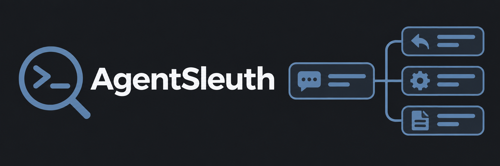

# AgentSleuth



AgentSleuth is a local desktop viewer for investigating conversations recorded by AI agents. It reconstructs sessions from **Codex**, **OpenCode**, **Claude Code**, and **Antigravity**. Follow each prompt through the agent's replies, tool executions, recorded output, and file changes in a searchable conversation tree.

AgentSleuth opens source evidence read-only and writes recovered files and attachments to a separate export directory.

## Quick start

```shell
git clone https://github.com/omaralaaaa/AgentSleuth.git
cd AgentSleuth
python -m pip install .
python main.py
```

You can also launch the installed viewer with `agentsleuth`. Run `python main.py --demo` to try a synthetic conversation without loading evidence.

## Open evidence

| Agent | Source to open | Companion evidence |
| --- | --- | --- |
| Codex | `state_5.sqlite` or another supported `state_*.sqlite` database | The referenced rollout JSONL files. Preserve their `sessions/` or `archived_sessions/` directory structure. |
| OpenCode | `opencode.db` | Sessions, messages, parts, and tool results are stored in the database. |
| Claude Code | `history.jsonl` | The sibling `projects/` tree contains session transcripts. Keep `file-history/` for available file backups. |
| Antigravity | `conversation_summaries.db`, a generated `transcript.jsonl`, or a trajectory `.db` | Preserve `brain/` and `conversations/`, including any session uploads and scratch files. |

Use a consistent snapshot for SQLite evidence. Recent records may still be in the `-wal` file, so a copy of the main database alone can have an incomplete timeline.

### Scan for sources

Click **Scan for artifacts…** above the agent tabs.

- **Scan this PC** checks known evidence locations under your home directory and accessible Windows profiles. It also checks locations configured with `CODEX_HOME`, `CLAUDE_CONFIG_DIR`, and `XDG_DATA_HOME`, and looks for Antigravity CLI evidence under `~/.gemini/antigravity-cli/`.
- **Scan evidence folder…** searches a selected folder, such as a KAPE collection with nested user profiles. Mount or extract a raw disk image before scanning its contents.

Use the checkboxes or **Select all**, then click **Open selected**. Double-click a folder name to open that source by itself. Multiple sources for the same agent open in separate tabs. When a folder contains several Codex state databases, the scanner selects the highest numbered one.

### Browse for a source

Select the agent tab and click **Browse** to load a source file. You can also paste its path and press **Enter**. To open an Antigravity folder directly, paste the directory containing `brain/` or `conversations/`.

## Review a conversation

1. Select a session in the **Conversation Index** to reconstruct it. The sidebar filter matches titles, working directories, and session IDs.
2. Press **Ctrl+F** to search the transcript. Search terms are case-insensitive and can appear in any order. Select **Entire conversation** or a specific turn, then narrow the results by activity type, tool name, or recorded status.
3. Click the response count beneath a prompt to expand or collapse its replies. Matching replies keep their parent prompt for context. Long tool outputs scroll inside their cards.

## Recover files and attachments

Click an exported filename to reveal the copy in your file manager. **Open export folder** opens the session's directory. **Uploads by prompt** links recorded uploads to their prompts, which you can read in full by selecting a prompt or file.

When you run `python main.py`, the default export root is `AgentSleuth_Export/` beside the script. The installed `agentsleuth` command uses `AgentSleuth_Export/` in the current directory by default. **Change folder** saves a custom location shared by all tabs. Pass `--export-root PATH` to use a different location for one launch.

Exports are grouped by agent and sanitized conversation title. Missing titles use `Unnamed_Conversation`. When titles collide, AgentSleuth adds a short session ID suffix. The `attachments/`, `recovered_files/`, and Antigravity `scratch/` subfolders are created as files are saved.

## Evidence coverage

- **Codex** reconstructs the rollout referenced by each thread. Prompt cards show the permission mode recorded in the turn context when available. Command cards show recorded output, with PowerShell syntax highlighting where applicable. Embedded files and recorded file changes can be exported. Inferred tool correlations are retained internally.
- **OpenCode** uses recorded sequence fields when available and falls back to timestamps and IDs. Repeated tool states within one message contribute to one execution card. Step markers and reasoning are omitted from the timeline. Recovery supports embedded uploads, tool-result attachments, completed writes with recorded content, and edits with a complete recorded final version.
- **Claude Code** groups history entries by session and reconstructs each conversation from its project transcript. Tool results are paired with their calls within the same branch. Recovery supports embedded attachments, complete recorded reads such as PDFs, writes, edits, and available file-history backups. Unconfirmed writes are labeled as proposed.

### Antigravity

AgentSleuth resolves session files within the selected evidence tree. When both formats are present, the generated transcript takes precedence over trajectory SQLite metadata.

| Session evidence | What the viewer can show or recover |
| --- | --- |
| `brain/<session-id>/.system_generated/logs/transcript.jsonl` | Prompts, replies, tool requests, recorded outputs, and errors. Step indices and truncation markers are shown when available. |
| `conversations/<session-id>.db` with a `steps` table | Ordered step indices and recorded numeric types and statuses. |
| Summary index only | Session title and recorded workspace. |
| `brain/<session-id>/.user_uploaded/` | Available uploads linked to their recorded prompts. |
| `brain/<session-id>/scratch/` | Session files copied byte for byte, with relative paths and searchable text previews up to 64 KiB. These files can be recovered with or without a transcript. |

Scratch recovery skips symlinks, junctions, dependency folders, and common caches. Standalone legacy `.pb` files and binary step payloads are unsupported.

## Troubleshooting

| Symptom | What to check |
| --- | --- |
| A session is listed but its transcript is missing | Check the companion files and their directory structure. The index can remain after a transcript is moved or removed. |
| A filename has no clickable copy | Check its status. The source may contain only a path, or the recorded content may be incomplete, invalid, or oversized. |
| A newly recorded event is missing | Refresh your evidence snapshot, then reload the source to clear that tab's session cache. |
| Search results are empty | Click **Clear** to reset the search and filter. Select **Entire conversation** to search all turns. |

## Development

Run `python main.py` from the checkout when editing the viewer. Use `python -m pip install -e .` to make the installed `agentsleuth` command use the checkout as well.

- Providers implement `load_threads(path)` for session discovery and `reconstruct_from_thread(path, thread, output_root, progress)` for conversation reconstruction. See the [provider packages](agentsleuth/parsers/).
- Search indexing, path handling, and artifact storage live in [core](agentsleuth/core/).
- Register new providers in the [Qt viewer](agentsleuth/ui/qt_app.py). Each tab runs its own background worker and renders cards near the visible area.

Run `python main.py --benchmark 1000` to measure transcript rendering with a synthetic conversation.
